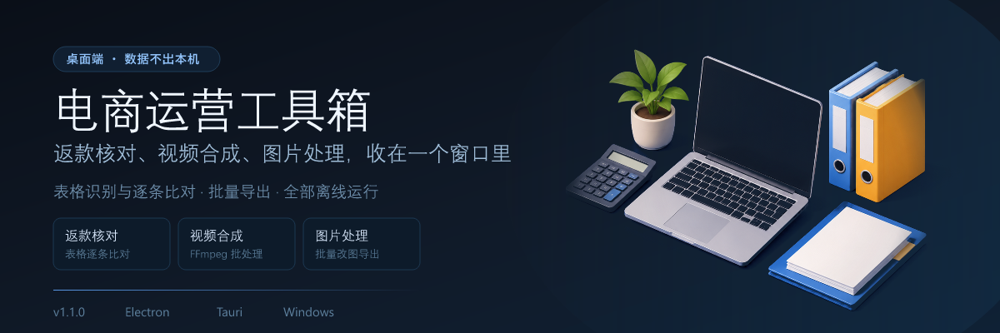

<p align="center">
  
</p>

<p align="center">
  <a href="#运行"></a>
  <a href="#隐私"></a>
  <a href="./LICENSE"></a>
</p>

电商运营的日常是散落在很多地方的：返款表格在一个文件夹，待发视频在另一个，商品图要改尺寸，核对结果还要发回群里。

**电商运营工具箱**把这些收进一个桌面窗口。所有处理都在本机完成，表格、图片、视频都不上传。

---

## 能做什么

| 模块 | 作用 |
| :--- | :--- |
| **返款核对** | 导入订单与返款表格，逐条比对金额与账号，标出不一致项 |
| **视频合成** | 基于 FFmpeg 批量合成、拼接、转码，支持模板化批量处理 |
| **图片处理** | 批量裁剪、缩放、格式转换与导出 |
| **OCR 识别** | 识别截图与表格图片中的关键字段，减少手工录入 |
| **结果导出** | 核对结果导出为表格，直接发给对方 |

---

## 运行

需要 Node.js 20+。

```bash
npm install
npm run dev        # 开发模式：Vite + Electron 同时启动
npm run build      # 类型检查 + 生产构建
npm run dist       # 打包 Windows 安装包（NSIS）
```

`npm run dev` 会起 Vite 开发服务器（`http://127.0.0.1:4181`）并随之拉起 Electron 窗口。

### 可用脚本

```bash
npm run typecheck       # 渲染进程 + Electron 主进程类型检查
npm run audit:prod      # 生产依赖安全审计
npm run perf:size       # 产物体积分析
npm run benchmark:native # 原生模块基准
```

---

## 技术结构

- **渲染层**：React + TypeScript + Vite
- **桌面壳**：Electron（默认）；仓库内另有 `tauri-app/` 的 Tauri 版本，供更小体积场景使用
- **原生能力**：FFmpeg 调用、路径安全校验、剪贴板与日志脱敏
- **数据**：全部落在本机，配置文件由用户自选路径

---

## 隐私

- 不上传任何表格、图片或视频；
- 剪贴板与日志模块含敏感信息脱敏（API Key、Bearer Token、手机号），详见 `tauri-app/src-tauri/src/clipboard.rs` 与 `log.rs`；
- 路径访问做安全校验，拒绝越界写入。

---

## 许可证

[MIT](./LICENSE)
